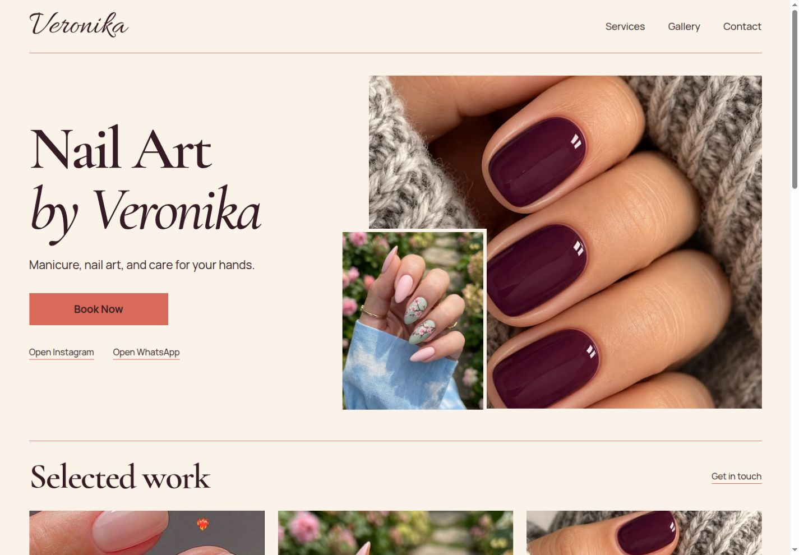
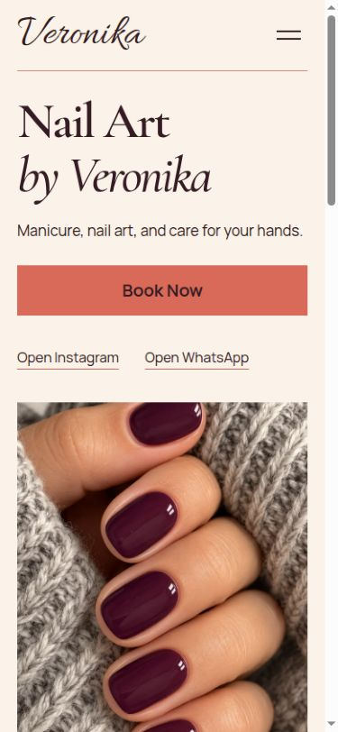
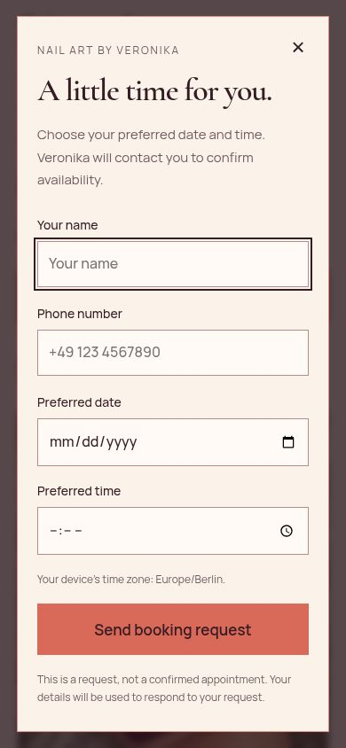

# Nail Art by Veronika

An elegant, responsive digital business card for a nail artist. Warm cream tones, coral accents and editorial typography frame a photo-led presentation of manicure services and selected designs.

Built as an English-language portfolio concept with HTML, CSS and vanilla JavaScript.

## Preview

### Desktop



### Mobile & booking request

<p>
  
  
</p>

Screenshots show the local implementation at desktop and mobile viewport sizes.

## Features

- Responsive layouts for desktop, tablet and mobile.
- Photo-led hero with a layered desktop composition.
- Manicure gallery with subtle hover effects.
- Soft, staggered photo entrances when images first enter the viewport; respects reduced-motion preferences.
- Four service descriptions: classic and express manicure, gel polish / Shellac, extensions and infills, spa care and nail art.
- Mobile navigation and a Contact dropdown with Instagram, WhatsApp and Get in touch.
- One shared booking dialog opened by Book Now and Get in touch.
- Required name, phone, preferred date and preferred time fields.
- Phone validation and rejection of past appointment dates and times.
- Keyboard-accessible native dialog, Escape-to-close, focus restoration and submission status messages.
- Custom manicure-inspired SVG favicon.

## Tech stack

| Technology | Purpose |
| --- | --- |
| HTML5 | Semantic sections, native dialog and form controls |
| CSS3 | Responsive grids, typography and visual styling |
| Vanilla JavaScript | Navigation, validation and booking interactions |
| Web Animations API & Intersection Observer | Lightweight photo entrance animations |
| EmailJS Browser SDK | Optional email delivery after configuration |
| Google Fonts | Allura, Cormorant Garamond and Manrope |

No framework, package installation or build step is required. Fonts and the EmailJS SDK are loaded from external providers.

## Run locally

Open the project folder in VS Code and use **Live Server**, or run a local server from the project root:

```bash
python3 -m http.server 5500
```

Then open [http://localhost:5500](http://localhost:5500).

## Booking email setup

**Email delivery is not configured in this concept.** With the default settings, the form explicitly states that no request was sent.

To enable delivery:

1. Create an EmailJS account and connect an email service.
2. Create a template with the nail artist’s recipient address configured in EmailJS.
3. Add these template variables:

   | Variable | Content |
   | --- | --- |
   | `{{user_name}}` | Customer name |
   | `{{user_phone}}` | Callback phone number |
   | `{{requested_date}}` | Preferred date |
   | `{{requested_time}}` | Preferred time |
   | `{{time_zone}}` | Customer device time zone |

4. Fill in `EMAIL_CONFIG` at the top of `script.js`:

```js
const EMAIL_CONFIG = {
  publicKey: "YOUR_EMAILJS_PUBLIC_KEY",
  serviceId: "YOUR_SERVICE_ID",
  templateId: "YOUR_TEMPLATE_ID",
};
```

Only the EmailJS public browser key belongs here; never add private keys or email account passwords. Configure allowed origins and abuse protection in EmailJS before making delivery public.

The form sends a **booking request**, not a confirmed appointment. It does not check a calendar, reserve slots or prevent two customers from requesting the same time. The nail artist must confirm availability separately.

Instagram and WhatsApp currently link to the services’ general websites rather than a specific account or recipient.

## Project structure

```text
veronika-card/
├── index.html
├── style.css
├── script.js
├── favicon.svg
├── images/
│   └── Manicure photographs
└── docs/
    └── screenshots/
        ├── desktop.png
        ├── mobile.png
        └── booking.png
```

## Deployment

Publish the project root on a static host such as GitHub Pages or Vercel. There is no build command; serve `index.html` alongside the CSS, JavaScript, favicon and image assets.

For GitHub Pages, select the branch containing these files and the `/ (root)` folder under **Settings → Pages**. All local assets use relative paths, including when hosted beneath a repository URL.

## Concept & credits

Created by **Olha Khodakivska** as a web development portfolio concept, based on supplied visual references and manicure imagery. Veronika is the concept brand; this repository does not represent a live booking business.

The supplied images are included for this concept. This repository does not grant rights to reuse them; verify image rights before commercial publication.
